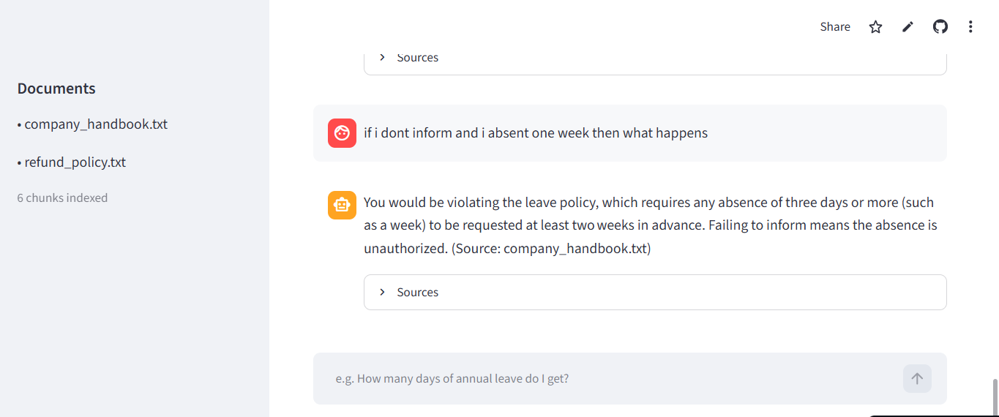

# Chat With Your Documents

Ask questions in plain English. The app finds the relevant passages in your documents and answers from them — with citations.

**Live demo:** https://chat-with-your-documents-v1.streamlit.app

A retrieval-augmented generation (RAG) app built with Python, Streamlit, fastembed and a free LLM API (Groq).

## What it does

- Put your documents (.txt or .pdf) in the `docs/` folder
- Ask a question in plain English
- The app finds the most relevant passages by meaning — not keywords — and answers only from them
- Every answer cites its source file, and it says "I don't know" when the documents don't contain the answer

## How it works

documents -> chunk -> embed -> retrieve -> generate answer

1. **Chunk** — split each document into overlapping ~500-character pieces
2. **Embed** — turn each chunk into a vector (384 numbers) capturing its meaning
3. **Retrieve** — embed the question, find the closest chunks by cosine similarity
4. **Generate** — hand those chunks to the LLM and ask it to answer only from them

## Why RAG

The model doesn't answer from its training memory — it reads your documents first. Answers are grounded in your content, verifiable, and the app won't invent facts.

## Run it locally

python -m venv .venv
.venv\Scripts\activate
pip install -r requirements.txt
streamlit run app.py

Create a `.env` file with your Groq key: GROQ_API_KEY="your_key_here"

## Tech

Python, Streamlit, fastembed (embeddings), Groq
